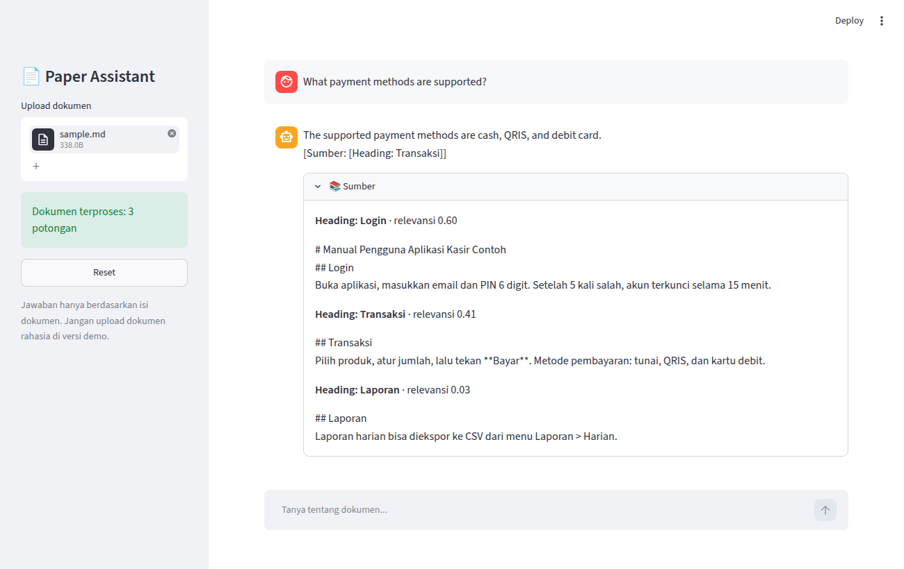

# Paper Assistant

Chatbot RAG untuk tanya-jawab berdasarkan isi satu dokumen, lengkap dengan sumber jawabannya. Final Project Hacktiv8.

**Demo:** https://chatbot-egarifs.streamlit.app/



## Fitur

- Upload 1 file: PDF, DOCX, MD, TXT (maks 20 MB). Termasuk hasil export Notion, Google Docs, Confluence, Obsidian.
- Tanya dalam Bahasa Indonesia atau Inggris; jawaban streaming.
- Setiap jawaban menyertakan sumber: `[Halaman X]` (PDF), `[Heading: H]` (MD), `[Bagian N]` (DOCX/TXT), beserta cuplikan dan skor relevansi.
- Jika jawaban tidak ada di dokumen: "Informasi ini tidak ditemukan dalam dokumen."
- Memahami pertanyaan lanjutan (4 pesan terakhir).

## Cara kerja

```
Upload → baca teks → potong (1000/200) → embedding lokal → FAISS (in-memory)
Pertanyaan → cari 8 potongan teratas → prompt + riwayat → Groq LLM → jawaban + sumber
```

| Komponen | Pilihan |
|---|---|
| UI | Streamlit |
| LLM | Groq `openai/gpt-oss-120b` |
| Embedding | `sentence-transformers/paraphrase-multilingual-MiniLM-L12-v2` (lokal) |
| Vector store | FAISS |
| Orkestrasi | LangChain |

## Menjalankan lokal

Butuh Python 3.11+ dan API key gratis dari https://console.groq.com/keys.

```bash
git clone https://github.com/egarifs/chatbot.git && cd chatbot
python -m venv .venv && . .venv/bin/activate
pip install -r requirements.txt
cp .env.example .env          # lalu isi GROQ_API_KEY
streamlit run app.py --server.address localhost
pytest                        # 12 test
```

## Evaluasi

20 pertanyaan terhadap dokumen PRD proyek: 10 yang jawabannya ada di dokumen, 10 yang tidak.

| Kategori | Hasil | Target |
|---|---|---|
| Ada di dokumen | 10/10 benar | ≥ 8/10 |
| Tidak ada di dokumen | 1/10 halusinasi | ≤ 1/10 |

## Batasan

- Satu dokumen per sesi; hilang saat halaman di-refresh atau Reset.
- PDF hasil scan (gambar) tidak bisa dibaca (tanpa OCR).
- Groq free tier dibatasi 8.000 token/menit (~4 pertanyaan/menit). Jika terlampaui, app mencoba ulang lalu menampilkan "Layanan AI sedang sibuk, coba lagi."
- Potongan dokumen yang relevan dikirim ke Groq. **Jangan upload dokumen rahasia ke versi demo.**
